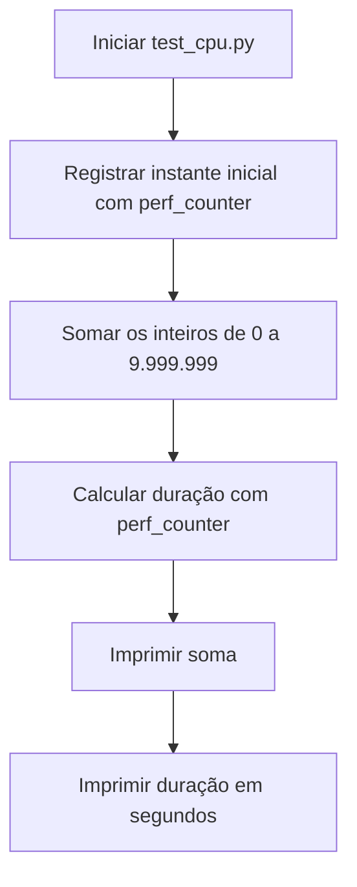

# Fluxo de execução

O diagrama mostra o caminho percorrido por `src/test_cpu.py` ao ser executado:

Não há entrada do usuário ou saída em arquivo: ambos os valores são escritos na saída padrão do processo.
